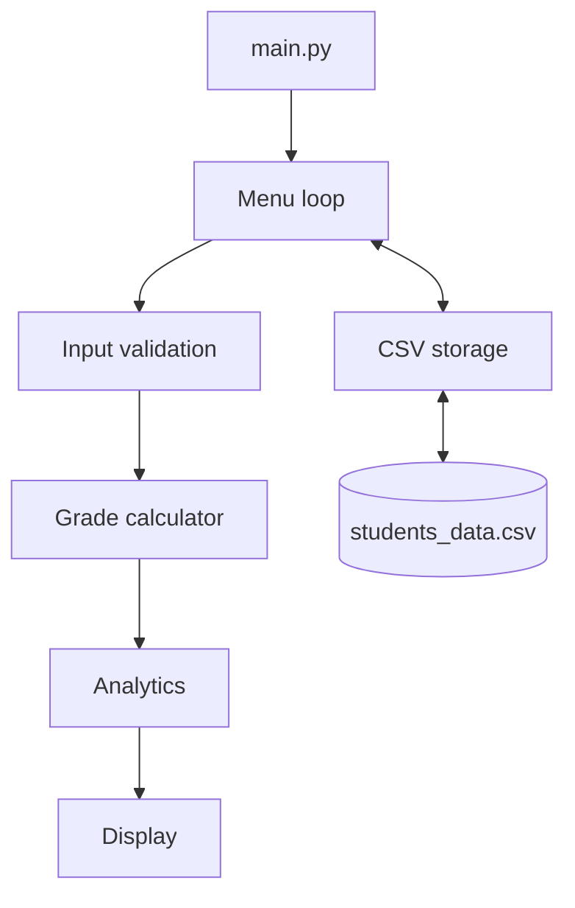

# 🎓 Student Grade Management System

A lightweight command-line app for managing student marks. Add students, get letter grades automatically, view class analytics, and keep everything saved in a simple CSV file. Pure Python, no installs needed.

---

## ✨ Features

- **Add students** with a unique ID, name, and marks (0–100)
- **Automatic letter grades** from `A+` to `F`
- **Class analytics**: average, pass rate, top and bottom performers, grade distribution
- **Search by ID** (case-insensitive)
- **Delete records** with a confirmation prompt
- **Safe saving**: data is written to a temp file first, then swapped in, so a crash can't corrupt your records
- **Self-healing loader**: bad rows in the CSV are skipped instead of crashing the app
- **Zero dependencies**: uses only Python's standard library

---

## 🚀 Quick Start

**Requirements:** Python 3.7 or newer. Check with `python --version` (use `python3` on macOS/Linux).

```bash
# 1. Get the project
git clone <your-repo-url>
cd student-grade-system

# 2. Run it
python main.py        # or: python3 main.py / py main.py (Windows)
```

On first run, `students_data.csv` is created automatically.

---

## 🖥 Usage

### Main menu

```text
======================================================
   🎓  STUDENT GRADE MANAGEMENT SYSTEM (CLI)  🎓
======================================================
  [1] Enroll / Add New Student
  [2] View All Students & Performance Analytics
  [3] Search Student by ID
  [4] Delete Student Record
  [5] Exit Application
======================================================
 Select an option (1-5):
```

### Records and analytics (option 2)

```text
========================================================================
             STUDENT ACADEMIC REGISTRY & PERFORMANCE SUMMARY
========================================================================
No.   | Student ID     | Student Name               | Marks      | Grade
------------------------------------------------------------------------
1     | STU101         | Jane Doe                   | 94.50      | A+
2     | STU102         | John Smith                 | 78.20      | B
3     | STU103         | Alice Williams             | 88.00      | A
4     | STU104         | Bob Martin                 | 54.00      | D
========================================================================
                       PERFORMANCE ANALYTICS
------------------------------------------------------------------------
 Total Enrolled Students : 4
 Class Average Marks     : 78.68 / 100.00 (Grade: B)
 Passing Rate            : 100.0%
 Highest Achiever        : Jane Doe (ID: STU101) - 94.50 marks [A+]
 Lowest Achiever         : Bob Martin (ID: STU104) - 54.00 marks [D]
------------------------------------------------------------------------
 Grade Distribution:
  ->  A+: 1 | A: 1 | B: 1 | C: 0 | D: 1 | F: 0
========================================================================
```

### Search (option 3)

```text
================================================
          SEARCH STUDENT RECORD BY ID
================================================
Enter Student ID to look up: STU101

 [✓] RECORD MATCH LOCATED:
------------------------------------------------
  • Student ID     : STU101
  • Full Name      : Jane Doe
  • Obtained Marks : 94.50 / 100.00
  • Letter Grade   : A+
------------------------------------------------
```

---

## 📐 Grading Scale

| Marks | Grade | Standing |
| :--- | :---: | :--- |
| 90.00 – 100.00 | `A+` | Outstanding |
| 80.00 – 89.99 | `A` | Excellent |
| 70.00 – 79.99 | `B` | Good |
| 60.00 – 69.99 | `C` | Satisfactory |
| 50.00 – 59.99 | `D` | Minimum pass |
| 0.00 – 49.99 | `F` | Fail |

A student **passes** with a grade of `D` or higher (50+ marks).

---

## ✅ Input Rules

| Field | Rule |
| :--- | :--- |
| **Student ID** | Required. Must be unique (case-insensitive, so `stu101` and `STU101` clash). |
| **Name** | Required. Leading and trailing spaces are trimmed. |
| **Marks** | A number from 0 to 100, decimals allowed. |

Invalid input never crashes the app. You are simply asked again.

---

## 💾 Data Storage

Records live in `students_data.csv` next to `main.py`:

```csv
ID,Name,Marks,Grade
STU101,Jane Doe,94.50,A+
STU102,John Smith,78.20,B
STU103,Alice Williams,88.00,A
```

- **Missing file?** A new one with the correct headers is created on startup.
- **Safe writes:** changes go to `students_data.csv.tmp` first, then replace the real file in one step.
- **Edited by hand?** Rows with missing fields or non-numeric marks are skipped. All valid rows still load.

> 💡 Tip: back up `students_data.csv` occasionally, since skipped rows are not recovered.

---

## 🏗 How It Works



| Layer | Responsibility |
| :--- | :--- |
| **Config** | File paths, CSV headers, grade thresholds |
| **Logic** | Grade calculation and statistics |
| **Storage** | Loading, atomic saving, row validation |
| **Validation** | Re-prompts until input is valid |
| **Display** | ASCII tables and summary dashboard |
| **Controller** | Menu dispatch and `Ctrl+C` handling |

Uses only the standard library modules `os`, `csv`, `sys`, and `typing`.

---

## 📁 Project Structure

```text
student-grade-system/
├── main.py             # Application code and CLI controller
├── README.md           # This file
└── students_data.csv   # Data file (created on first run)
```

---

## 🔧 Troubleshooting

**`python` is not recognized (Windows)**
Reinstall Python with **"Add Python to PATH"** ticked, or run `py main.py` instead.

**`python` not found (macOS/Linux)**
Use `python3 main.py`.

**I deleted `students_data.csv`. Is that a problem?**
No. A fresh empty file is created next time you start the app (your old records are gone, though).

**How do I quit?**
Choose option `[5]`, or press `Ctrl + C` at any prompt. Both exit cleanly.

---

## 🗺 Ideas for Future Improvements

- [ ] Edit an existing student's marks
- [ ] Sort and filter the records table
- [ ] Support multiple subjects per student
- [ ] Export reports to a separate file

---

## 🤝 Contributing

Suggestions and pull requests are welcome. For larger changes, please open an issue first to discuss what you'd like to change.

## 📄 License

Released under the [MIT License](LICENSE).